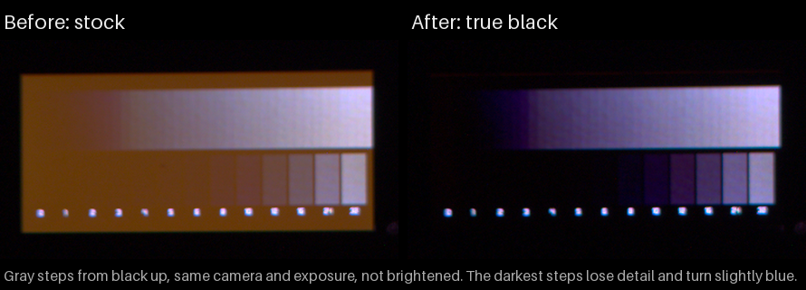

# Validation notes: comma four black level

Two stacked kernel changes for the comma four (mici) screen, whose black areas glow red:

1. [#1](https://github.com/alanbixby/agnos-kernel-sdm845/pull/1) runs the panel's own startup commands after the bootloader hands the screen over, with one panel register bit set (`FE05:2A = 01`).
2. [#2](https://github.com/alanbixby/agnos-kernel-sdm845/pull/2) also lowers the panel's ELVSS supply to -3.5 V during that restart.

All results are from one comma four, on AGNOS 20.2 with openpilot master. Each test kernel was built by fork CI and flashed to slot b only. Slot a stayed stock.

## How the glow was measured

- **Camera:** a Samsung S21 Ultra in a fixed position in a dark room. Pro mode RAW, ISO 50, 4 s, manual focus, the same for every photo.
- **Number:** the average raw red value (the red pixels of the RAW file, before any processing) in two fixed areas either side of the logo, minus the same areas with the display switched off. [measure.py](measure.py) has the areas. Higher means more glow; 0 is a switched-off screen.
- **Screens:**
  - The comma logo that AGNOS shows while openpilot is stopped. It is drawn after the kernel starts, unlike the bootloader's logo.
  - An all-black screen, using the panel's "all pixels off" mode. That mode glows like black pixels: with only the panel fix it measured 35, close to the logo screen's 37.
- **Brightness:** 165, except in the full-white test.
- **Data and images:** [measurements.csv](measurements.csv) has every value and the build each photo came from. The images were made from the RAW files with [render_r3.py](render_r3.py), brightened 2x the same way for every tile.

| State | All-black screen | Logo screen |
|---|---|---|
| Stock kernel | 123 | 131 |
| Panel fix (#1) | 35 | 37 |
| Panel fix and -3.5 V (#2) | 2 | 8.5, mostly glare from the logo |

Where the photos came from:
- **Stock:** taken after a warm reboot. Stock can glow more after a cold boot; an earlier session, on AGNOS 19.8.1 with a black page, measured 225.
- **Panel fix:** from #2's test build with the voltage set to 0. That build leaves the PMIC at stock, so it shows #1 alone.
- **-3.5 V, all-black:** from #2's final build.
- **-3.5 V, logo:** from an earlier build of #2 that sets the same voltage. It was taken about 30 minutes earlier, and the camera sits a few pixels differently in that photo.

## #1: run the panel init after continuous splash

Tested:
- **Boot:** the panel fix is in place before the first frame, with no display errors.
- **Daily use:** the openpilot UI works, and restarting it works. Sleep and wake were tested with #2 applied.
- **Boot time:** the screen blinks once, and boot takes about 0.63 s longer. Timing points in a test build put almost all of that in the panel restart.
- **Other values:**
  - A restart with the bit clear, done by a test tool, measured 133 on the logo screen, the same as stock. So the bit does the work, not the restart.
  - Bit 2 (`04`, from comma's `screen_elvss_2.4v` branch) looked the same as the bit clear on a webcam.
  - A blind A/B by eye found no difference between `01` and `05`.
- **Reviews:** five rounds of automated review by two AI models (Claude and GPT), with no open findings. Two later changes, wording and the bit value (05 to 01), came after the fifth round.

A full display power-up after a second openpilot UI exits leaves the screen dark until a reboot. This happens on the stock kernel too, so it is not caused by this change.

Not tested: the provisioning board, which uses the same panel, and other units.

## #2: set the ELVSS to -3.5 V in the splash reinit

Tested, with the kernel log line for each:

| Test | Result |
|---|---|
| First boot from stock | "IBB voltage set to 3500000 uV"; both supplies regulating |
| Warm reboot | "IBB voltage 3500000 uV kept"; nothing written |
| Test build with the value 0 | "IBB voltage override cleared"; back to stock |
| Stock kernel after a -3.5 V boot | still -3.5 V, as documented |
| Software poweroff, then power on | cold boot; the kernel set -3.5 V again |
| openpilot restart, screen sleep and wake | supplies off while asleep, -3.5 V kept, back on after a tap |
| Full white at brightness 255 for 20 minutes (earlier build) | 80 checks, all unchanged: voltage held, both supplies regulating, no short flagged; 30-37 °C |

These ran on three builds of #2 that set the voltage the same way, plus the test build with the value 0. The final change only fixed a log message, and its build was checked again on the device.

- **Display log:** no errors beyond those on the panel-fix boots.
- **Reviews:** three rounds of automated review by two AI models (Claude and GPT). The third round's findings, on wording and one log message, are fixed.
- **Write checks:** a host simulation built from this code ran 34 scenarios and about 725,000 fault-injection cases, including shorts, supplies coming back on, read errors and failed writes. No write happened after a read showed a supply on or a short. No software check can catch a supply that turns on between the last check and the write, or a read that returns a wrong value.
- **Failure paths:** tested only in that simulation. If the voltage can't be confirmed, or a short is flagged while -3.5 V is set, the screen stays dark and the kernel log says why. The next wake from sleep turns it back on.
- **Build:** a local build without CI's `-w` shows no new warnings, with SPMI built in, as a module, or off.

**Cost:** dark grays get darker. In an earlier session on this unit, both fixes were set by a test tool, with the bit as 05 rather than 01; the two measured the same for glow. At brightness 165, compared with the panel bit alone:
- the gray steps 32, 16 and 12 lost about 8%, 22% and 39% of their light, and turned slightly blue;
- white and mid grays were 2-3% dimmer;
- a faint line stays along the top edge.

## Not tested

- Other units. The glow varies between units.
- Low brightness, where dark grays likely lose more.
- Temperature extremes and long-term use.
- The bootloader's comma logo still glows. It is drawn before the kernel runs, by comma's XBL, which would need the same two changes.
