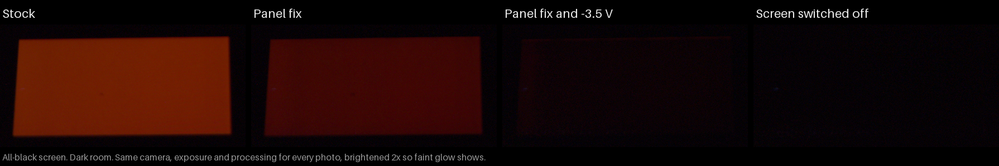
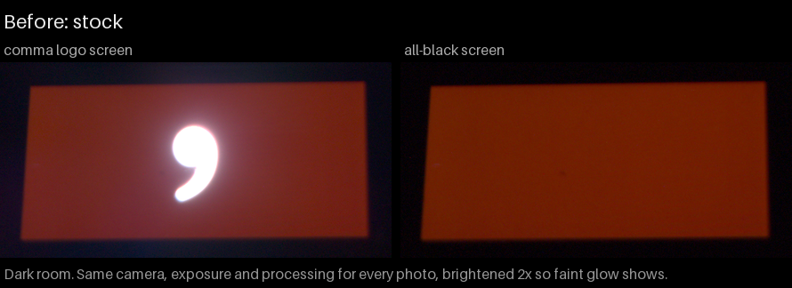
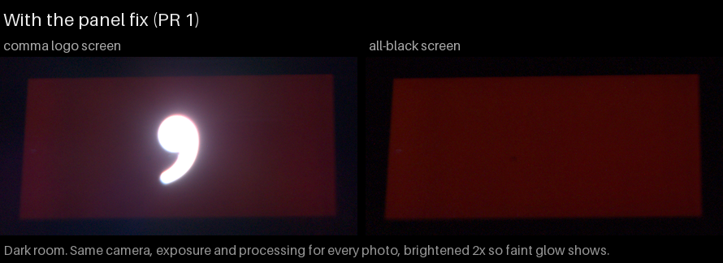
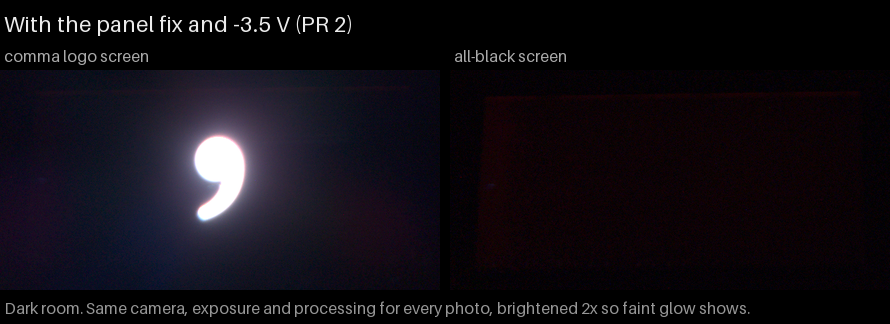

# Validation notes: comma four black level

Two stacked kernel changes for the comma four (mici) screen, whose black areas glow red:

1. [#1](https://github.com/alanbixby/agnos-kernel-sdm845/pull/1) runs the panel's own startup commands after the bootloader hands the screen over, with one panel register bit set (`FE05:2A = 01`).
2. [#2](https://github.com/alanbixby/agnos-kernel-sdm845/pull/2) also lowers the panel's ELVSS supply to -3.5 V during that restart.

All results are from one comma four, on AGNOS 20.2 with openpilot master. Each test kernel was built by fork CI and flashed to slot b only. Slot a stayed stock.

## How the glow was measured

- **Camera:** a Samsung S21 Ultra in a fixed position in a dark room, Pro mode RAW, ISO 50, 4 s, manual focus. Every photo used the same settings.
- **Number:** the average red value in two fixed areas of the screen, minus the same areas with the display switched off. Higher means more glow; 0 is a switched-off screen.
- **Screens:** the comma logo screen, and an all-black screen using the panel's "all pixels off" mode. That mode shows the same glow as black pixels: with only the panel fix it still measured 35.
- **Brightness:** 165 throughout.
- **Data and images:** [measurements.csv](measurements.csv) has every value. The images were made from the RAW files with [render_r3.py](render_r3.py), brightened 2x the same way for every tile.

| State | All-black screen | Logo screen |
|---|---|---|
| Stock kernel | 122 | 131 |
| Panel fix (#1) | 35 | 37 |
| Panel fix and -3.5 V (#2) | 2 | 8.5, mostly glare from the logo |

The stock figure is after a warm reboot. An earlier session measured 225 for stock after a cold boot.

## #1: run the panel init after continuous splash

Tested:
- **Boot:** the panel fix is in place before the first frame, with no display errors.
- **Daily use:** the openpilot UI works, and restarting it and sleep and wake both work.
- **Boot time:** the screen blinks once, and boot takes about 0.63 s longer. Timing points in a test build put almost all of that in the panel restart.
- **Other values:** bit 2 (`04`, from comma's `screen_elvss_2.4v` branch) measured like a plain restart. A blind A/B by eye found no difference between `01` and `05`.
- **Reviews:** five rounds by two reviewers, with no open findings.

A full display power-up after a second openpilot UI exits leaves the screen dark until a reboot. This happens on the stock kernel too, so it is not caused by this change.

## #2: set the ELVSS to -3.5 V in the splash reinit

Tested, with the kernel log line for each:

| Test | Result |
|---|---|
| First boot from stock | "IBB voltage set to 3500000 uV"; both supplies regulating |
| Warm reboot | "IBB voltage 3500000 uV kept"; nothing written |
| Test build with the value 0 | "IBB voltage override cleared"; back to stock |
| Stock kernel after a -3.5 V boot | still -3.5 V, as documented |
| Software poweroff, then power on | cold boot; the kernel set -3.5 V again |
| openpilot restart, screen sleep and wake | supplies off while asleep, -3.5 V kept, back on after a tap |
| Full white at brightness 255 for 20 minutes | 80 checks, all unchanged: voltage held, both supplies regulating, no short flagged; 30-37 °C |

- **Display log:** no errors beyond those on the panel-fix boots.
- **Reviews:** two rounds by two reviewers. All their findings are fixed; a third round is checking the fixes.
- **Write checks:** checked in a host simulation built from the exact code. It ran 34 scenarios and about 725,000 fault-injection cases, including shorts, supplies coming back on, read errors and failed writes. No write happened while a supply was on or a short was flagged.
- **Build:** a local build without CI's `-w` shows no new warnings, with SPMI built in, as a module, or off.

## Not tested

- Other units. The glow varies between units.
- Temperature extremes and long-term use.
- The bootloader's comma logo still glows. It is drawn before the kernel runs, by comma's XBL, which would need the same two changes.
